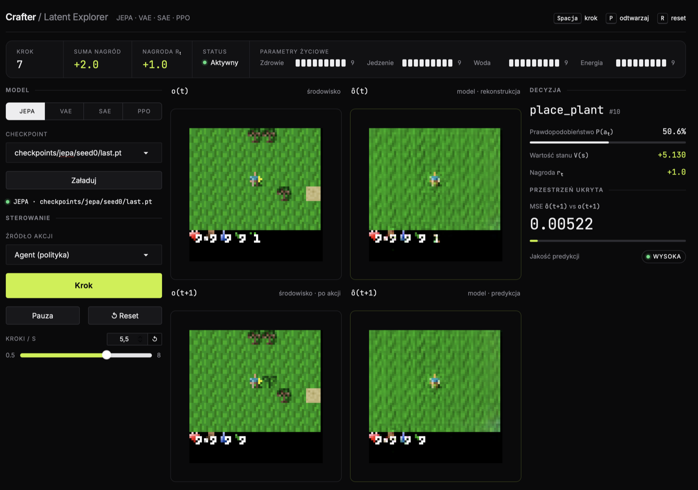
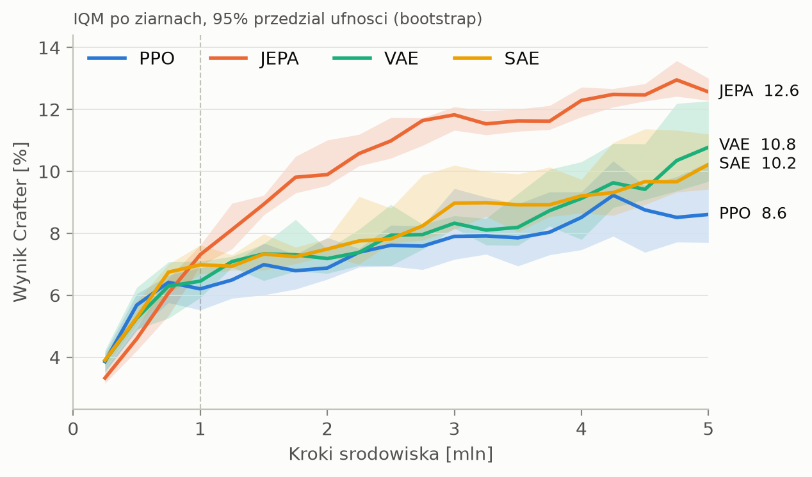

# Crafter2D Latent Space Analysis
**Does an auxiliary objective on the encoder make PPO better at Crafter, and what do the learned latent spaces look like?**

Four agents, same IMPALA encoder and PPO hyperparameters, differing only in an extra loss on the encoder. Trained 5M env steps × 5 seeds on [Crafter](https://github.com/danijar/crafter), then frozen and analysed post-hoc (geometry, probes, occlusion, ablation).



*`just app`: step a trained agent, see its action distribution, value, reconstruction ô(t) and predicted next frame ô(t+1).*

## Results in one minute

| | PPO | JEPA | VAE | SAE |
|---|---|---|---|---|
| Crafter score @ 5M (IQM, 95% CI) | 8.6 [7.7, 10.3] | **12.6** [12.3, 13.0] | 10.8 [9.7, 12.3] | 10.2 [9.4, 11.2] |
| P(JEPA > X) @ 5M | 1.00 | – | 0.88 | 1.00 |

- **JEPA wins**: best score and tightest CI; better than every other method on P(X > Y). VAE and SAE beat plain PPO (SAE only marginally); they don't differ from each other
- **JEPA's latent space is different**: highest effective rank (97 vs ~69), smoothest in time, most linearly predictable (R²(z<sub>t+1</sub>) 0.92 vs 0.77–0.80), least similar to the others (CKA ≈ 0.6 vs 0.73–0.77)
- **Every encoder reads the HUD**: vitals are linearly decodable (selectivity 0.45–0.79) and occlusion shows the probes read their own HUD icon
- **The policy uses few directions**: removing the top 16 PCs of z costs ~100% of the effect of removing all of z; JEPA's policy is the most concentrated (top-4 PCs = 65% vs 37–47%)



Full write-up with all figures and caveats: **[docs/results.md](docs/results.md)**.

## The four agents

| `--algo` | Extra loss on the encoder |
|---|---|
| `ppo` | none (baseline) |
| `jepa` | predict the next latent of an EMA target encoder + variance hinge |
| `vae` | reconstruct the frame + KL to N(0, I) |
| `sae` | reconstruct the frame + sparsity of a hidden code |

Shared: IMPALA CNN → 256-d z → actor/critic; 8 envs, 512 steps per env per update, 1221 updates ≈ 5M steps.

## Quickstart

```bash
uv sync
wandb login
just train jepa 0      # algo, seed → checkpoints/jepa/seed0/last.pt
just app               # Gradio Latent Explorer on any checkpoint
just check             # ruff + ty
```

## Pipeline

```
just train / just sweep ──► W&B runs ──► just compare            (scores, significance)
         │
         └► checkpoints ──► just eval-buffer ──► just latent-comparison  (geometry)
                                              ├► just xai                (probes)
                                              ├► just occlusion          (occlusion maps)
                                              └► just ablation           (subspace ablation)
```

| Command | What it does | Output (`plots/`) |
|---|---|---|
| `just train <algo> <seed>` | one training run | `checkpoints/<algo>/seed<s>/last.pt`, W&B run |
| `just sweep <algo>` | seeds 0-4 | same |
| `just compare` | W&B runs by tag → rliable Mean/IQM, P(X > Y), Welch | `aggregate_*`, `probability_of_improvement_*`, `sample_efficiency`, `achievements` |
| `just eval-buffer` | four frozen 5M policies play 40k frames; every frame encoded by every encoder | `eval_buffer/buffer.npz` |
| `just latent-comparison` | CKA, TwoNN, effective rank, UMAP, temporal smoothness | `cka_matrix`, `dimensions`, `umap`, `temporal` |
| `just xai` | linear + MLP probes of vitals, control tasks | `probe_r2`, `probe_selectivity` |
| `just occlusion` | 9×9 cell occlusion → Δz, Δ probe output | `occlusion` |
| `just ablation` | mean-ablate subspaces of z → KL of the policy | `ablation_kl` |
| `just train-predictor <last.pt>` | next-frame decoder on a frozen policy (for the app only) | `<ckpt dir>/predictor/` |

- Every analysis writes PNG + PDF + CSV; plot text is in Polish
- Post-hoc metrics: episode bootstrap, 1000 reps, 95% CI
- Configs: `latent_rl/config/<script>_config.yaml`

## Layout

```
latent_rl/
  scripts/    entry points (one per just recipe)
  trainers/   PPOTrainer + JEPA / VAE / SAE subclasses
  modules/    encoder, decoder, actor-critic, JEPA, VAE, SAE, predictor
  envs/       Crafter gym wrapper, vec env
  analysis/   post-hoc latent metrics (bootstrap, CKA, dimensions, temporal, UMAP)
  xai/        probes, occlusion, ablation
  app/        Gradio Latent Explorer
  utils/      EvalBuffer, rollout buffer, diagnostics, plotting
  config/     YAML per script / algo
slurm/        WCSS cluster jobs
docs/         results write-up + figures
```

## Running on the WCSS cluster

```bash
slurm/sync.sh                                           # rsync tree to wcss:~/latent_rl
ssh wcss 'cd latent_rl && sbatch slurm/setup.sbatch'    # venv, once per dependency change
ssh wcss 'cd latent_rl && sbatch slurm/train.sbatch'    # 4 algos × 5 seeds, tag main-5m
ssh wcss 'cd latent_rl && sbatch slurm/predictor.sbatch <path/to/last.pt>'
```

- Smoke test: `sbatch --array=0,5,10,15 --time=0:30:00 --export=ALL,TAG=smoke,N_ITER=25 slurm/train.sbatch`
