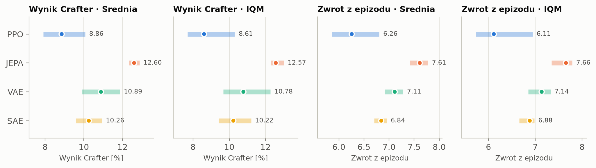
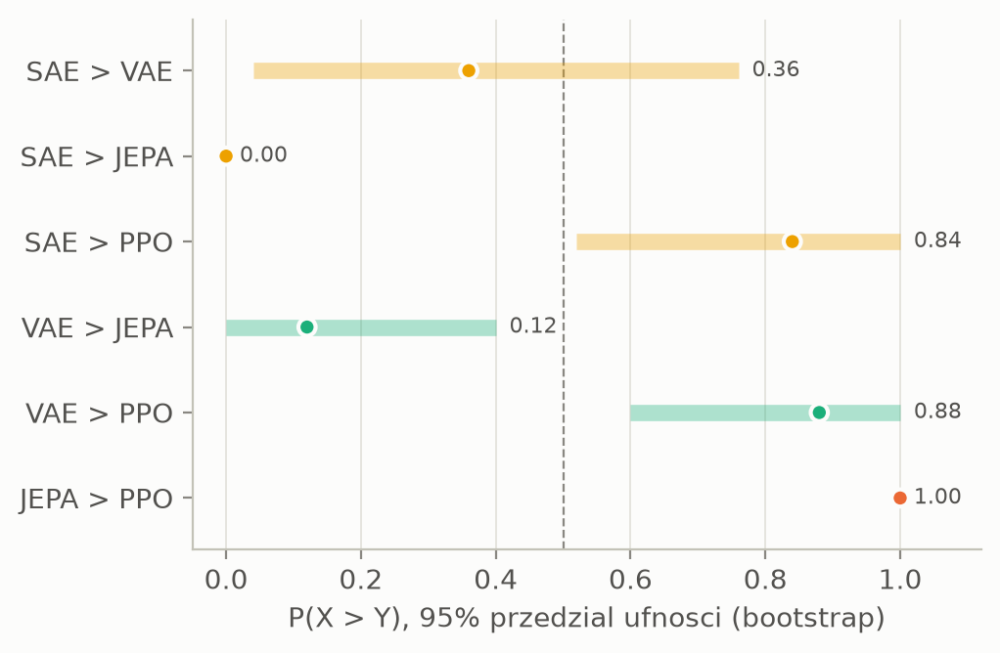
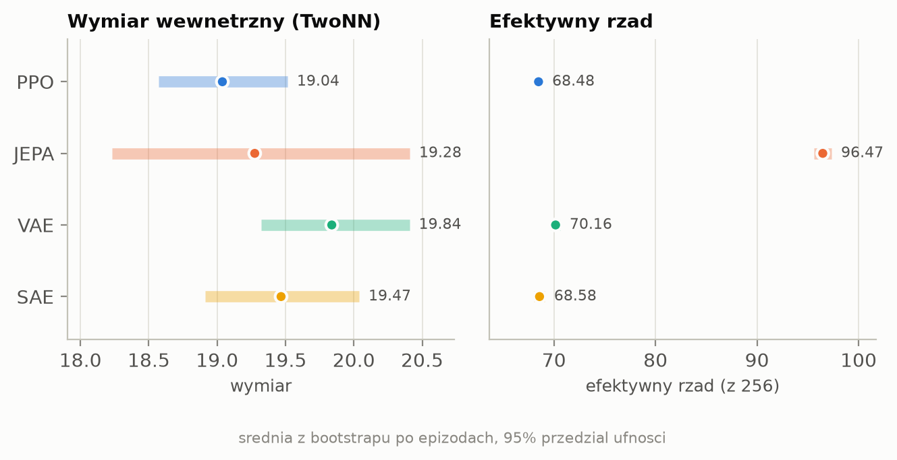
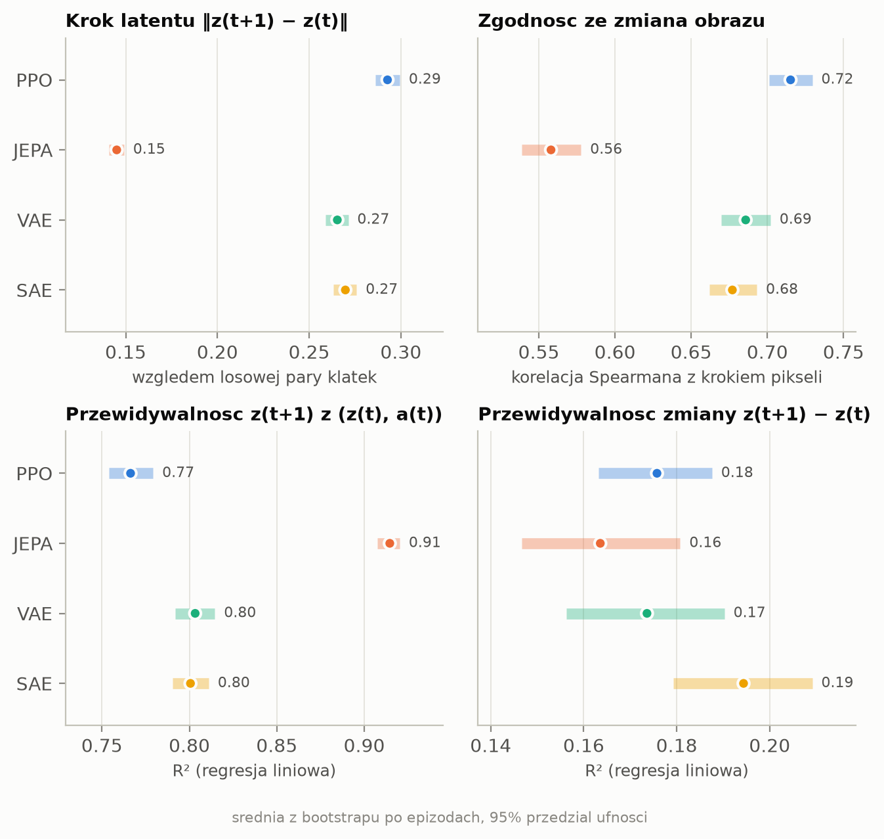
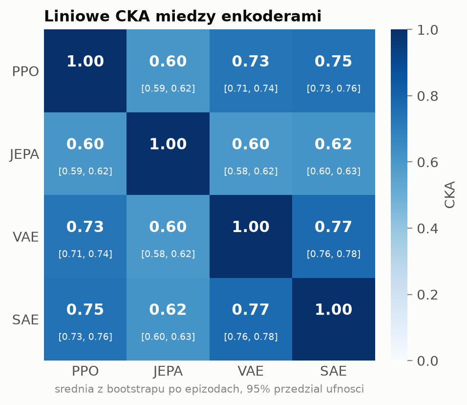
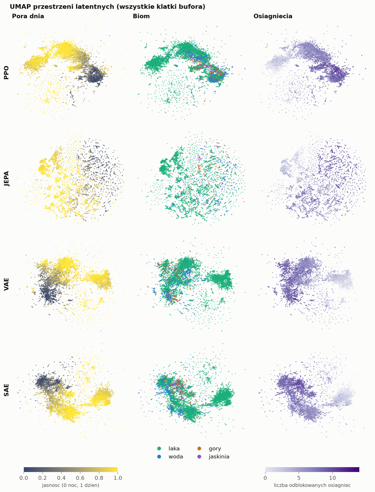
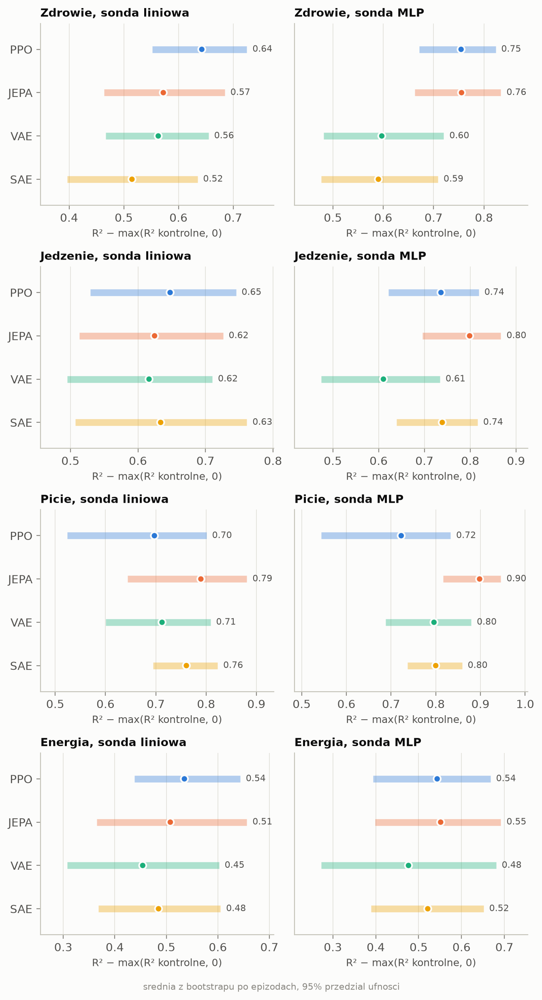
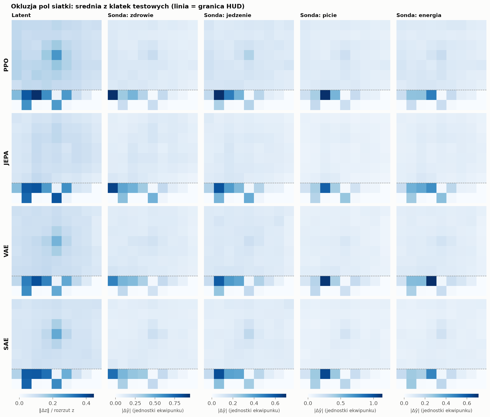
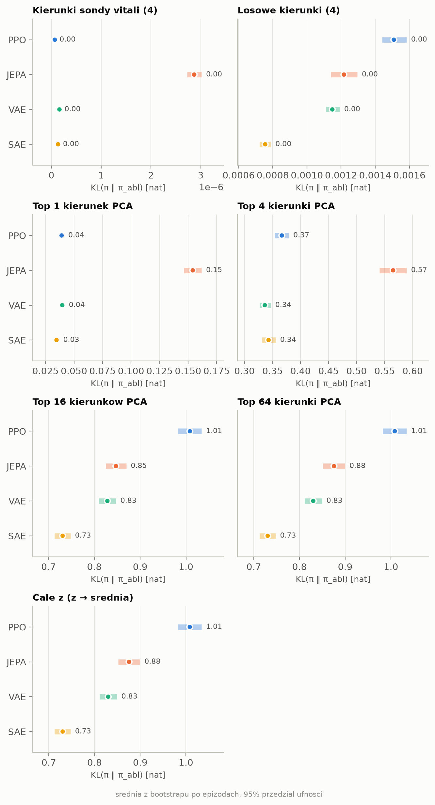

# What does an auxiliary encoder loss buy a PPO agent in Crafter?

PPO learns its encoder from reward alone. A common fix is an extra self-supervised loss on the encoder. This write-up compares three such losses against plain PPO on [Crafter](https://github.com/danijar/crafter). It asks two questions:

1. Which loss gives the best agent?
2. How do the learned latent spaces differ, and which parts of them does the policy actually use?

Plot labels are in Polish: *Wynik* = score, *Srednia* = mean, *Kroki srodowiska* = env steps.

## Setup

| Agent | Extra loss on the encoder |
|---|---|
| PPO | none |
| JEPA | predict the next frame's latent from an EMA target encoder, plus a variance hinge against collapse |
| VAE | reconstruct the frame, plus KL to N(0, I) |
| SAE | reconstruct the frame, plus sparsity of a hidden code |

**Shared across all four agents**
- IMPALA CNN → 256-d z → actor / critic.
- Identical PPO hyperparameters: 8 envs, 512 steps per env per update, 4 epochs, entropy coefficient decayed from 0.02 to 0.005.
- 5M env steps × 5 seeds per method, run on 1×H100 per run on the WCSS cluster.

**Score.** Crafter score (Hafner 2021) is exp(mean(log(1 + s<sub>i</sub>))) − 1 over the success rates s<sub>i</sub> (in %) of the 22 achievements. Each run's score is averaged over the last 250k steps before the budget. Across seeds it is aggregated with [rliable](https://github.com/google-research/rliable): Mean and IQM with 95% stratified-bootstrap CIs, and probability of improvement P(X > Y).

**Post-hoc analysis**
- One frozen 5M checkpoint per method plays 10k frames on shared env seeds, giving 40k frames and 217 episodes.
- Every frame is encoded by all four encoders, so every comparison uses the same frames.
- Uncertainty comes from an episode bootstrap: 1000 reps, stratified by the policy that played.

## 1. Performance: JEPA is the best agent

| Crafter score | PPO | JEPA | VAE | SAE |
|---|---|---|---|---|
| IQM @ 1M | 6.2 [5.5, 6.9] | **7.3** [7.0, 7.6] | 6.5 [5.9, 7.1] | 7.0 [6.7, 7.6] |
| IQM @ 5M | 8.6 [7.7, 10.3] | **12.6** [12.3, 13.0] | 10.8 [9.7, 12.3] | 10.2 [9.4, 11.2] |






**Probability of improvement at 5M.** A pair counts as different when the CI of P(X > Y) excludes 0.5.
- JEPA > every other method:
  - P = 1.00 vs PPO;
  - 0.88 vs VAE;
  - 1.00 vs SAE.
- VAE > PPO (0.88) and SAE > PPO (0.84). The SAE result is marginal: its CI lower bound is 0.52 and Welch p = 0.09.
- VAE and SAE are indistinguishable (0.36 [0.04, 0.76]).

**Learning curves**
- All methods are tied for the first ~1M steps.
- JEPA separates from about 1.5M steps onwards and keeps the narrowest band across seeds.

**Where the gap comes from.** Success rate (%) on the achievements that differ, mean over seeds:

| | PPO | JEPA | VAE | SAE |
|---|---|---|---|---|
| collect_sapling | 64 | **85** | 69 | 66 |
| collect_stone | 38 | **57** | 43 | 41 |
| place_furnace | 1 | **26** | 6 | 2 |
| collect_coal | 8 | **19** | 12 | 10 |
| defeat_zombie | 19 | 33 | **43** | 38 |
| eat_cow | 15 | 8 | **32** | 23 |

- JEPA gets further along the crafting tree: stone, then furnace, then coal.
- The reconstruction agents (VAE, SAE) fight and hunt more.

## 2. Latent geometry: JEPA's space is higher-rank, smoother and more predictable

| | PPO | JEPA | VAE | SAE |
|---|---|---|---|---|
| effective rank (of 256) | 68.5 | **96.5** | 70.2 | 68.6 |
| TwoNN intrinsic dim. | 19.0 | 19.3 | 19.8 | 19.5 |
| latent step (lower = smoother) | 0.29 | **0.15** | 0.27 | 0.27 |
| corr(latent step, pixel step) | 0.72 | **0.56** | 0.69 | 0.68 |
| R² of z<sub>t+1</sub> from [z<sub>t</sub>, a<sub>t</sub>] (linear) | 0.77 | **0.92** | 0.80 | 0.80 |
| R² of Δz (linear) | 0.18 | 0.16 | 0.17 | 0.19 |

**Metric definitions**
- **Effective rank.** exp of the entropy of the normalized singular values.
- **TwoNN** (Facco et al. 2017). Uses a Theiler window of 50 steps. Without the window it measures the 1-D trajectory (ID ≈ 1.5).
- **Latent step.** Mean ‖z<sub>t+1</sub> − z<sub>t</sub>‖ divided by the mean distance to a random frame.
- **R² of z<sub>t+1</sub>.** A linear map is fit once on train episodes and scored on held-out episodes.





**Reading the table**
- All encoders live on a manifold of about 19 dimensions.
- JEPA spreads its variance over many more directions (rank 97 vs ~69).
- JEPA moves less per step and tracks pixel change less. It encodes *what changed in the game*, not *how many pixels changed*.
- The high R² of z<sub>t+1</sub> for JEPA is partly by construction, since its loss predicts z<sub>t+1</sub>. The R² of the change Δz is the same for everyone (≈ 0.17): no encoder makes the dynamics themselves linear.



**Linear CKA**
- PPO, VAE and SAE are similar to each other (0.73–0.77).
- JEPA is the odd one out (≈ 0.60 to everyone).
- The two reconstruction losses are the closest pair (0.77).



**UMAP.** Columns are coloured by daylight, biome and achievements unlocked so far.
- PPO, VAE and SAE form a few large blobs split by day/night and progress.
- JEPA breaks into many short trajectory strands, with day/night as the coarse axis.

## 3. Probes: every encoder carries the player's vitals

**Question.** Can health, food, drink and energy be read off z?

**Probes**
- Two probe types:
  - linear: StandardScaler + Ridge;
  - MLP: 1 × 256 hidden units.
- Fit on train episodes and scored on held-out episodes (every 5th).

**Control task** (Hewitt & Liang 2019)
- Frames are clustered into 250 "types" by k-means on 16×16 downsampled pixels. This step does not depend on any encoder.
- Each type gets one random label. A probe that only memorizes frames would do as well on these labels as on the real ones.
- **Selectivity** = R²(real) − max(R²(control), 0).

Selectivity (linear | MLP):

| | PPO | JEPA | VAE | SAE |
|---|---|---|---|---|
| health | .64 \| .75 | .57 \| .76 | .56 \| .60 | .52 \| .59 |
| food | .65 \| .74 | .62 \| .80 | .62 \| .61 | .63 \| .74 |
| drink | .70 \| .72 | **.79 \| .90** | .71 \| .80 | .76 \| .80 |
| energy | .54 \| .54 | .51 \| .55 | .45 \| .48 | .48 \| .52 |



**Findings**
- Vitals are decodable from every encoder, and mostly linearly.
- Control R² is near zero (linear 0–0.13), so the probes are not memorizing frames.
- The VAE has the highest control R² (~0.13). Its latents preserve pixel similarity, so frames that look alike map to nearby z, which is exactly what the control task rewards.
- Linear probes: the CIs of all four encoders overlap on every vital.
- MLP probes separate the encoders a little: JEPA drink (.90) is above PPO (.72), and PPO/JEPA health (~.75) is above VAE/SAE (~.60). Non-linear readout helps PPO and JEPA more.

## 4. Occlusion: the probes read the HUD icons

**Method**
- The 64×64 frame is split into a 9×9 grid of 7-px cells: 7 rows of world view and 2 rows of HUD inventory.
- One cell at a time is replaced by the mean frame, over 500 held-out frames.
- Two maps are measured:
  - **latent**: ‖Δz‖ relative to the RMS spread of z;
  - **per vital**: |Δŷ| of the linear probe.



**What the vitals probes read**
- Each probe peaks on its own HUD icon: health (7,0), food (7,1), drink (7,2), energy (7,3).
- They also respond to correlated HUD cells:
  - the other vitals;
  - the wooden pickaxe and sword, which act as cues for how far the episode has progressed.
- World cells move the prediction by ≤ ~0.1 inventory units.
- So "vitals are decodable" here means "the encoder carries the HUD readout". The probes are not inferring health from the scene.

**What moves z itself**
- PPO, VAE and SAE react most to the player's cell and the cells around it.
- JEPA is nearly flat over the world view and reacts mainly to the HUD (wood, pickaxe, sword).
- PPO has the strongest HUD response (food, drink, wood).

## 5. Ablation: the policy depends on about 16 directions of z

**Why subspaces, not neurons.** z has no privileged basis: the encoder ends in Linear → LayerNorm and the actor starts with a Linear. So we remove data-defined subspaces instead of single neurons.

**Method**
- Mean-ablation: z ← z − (z − z̄) B Bᵀ for an orthonormal basis B.
- The effect is KL(π ‖ π<sub>ablated</sub>), averaged over all 40k frames.
- Subspaces removed:
  - **vitals**: the linear probe's readout directions;
  - **random**: the same number of random directions, as a control;
  - **pca_k**: the top-k principal components (pca_256 sets z to z̄ and gives the upper bound).

| KL [nats] | PPO | JEPA | VAE | SAE |
|---|---|---|---|---|
| vitals (4 dirs) | ~1e-6 | ~1e-6 | ~1e-6 | ~1e-6 |
| random (4 dirs) | .0015 | .0012 | .0012 | .0008 |
| top-1 PC | .04 | **.15** | .04 | .03 |
| top-4 PCs | .37 | **.57** | .34 | .34 |
| top-16 PCs | 1.01 | .85 | .83 | .73 |
| all of z (bound) | **1.01** | .88 | .83 | .73 |



**Concentration.** As a fraction of the bound:

| | PPO | JEPA | VAE | SAE |
|---|---|---|---|---|
| top-1 PC | 4% | **17%** | 5% | 5% |
| top-4 PCs | 37% | **65%** | 41% | 47% |
| top-16 PCs | ~100% | 97% | ~100% | ~100% |

**Findings**
- The policy depends on z only through its top ~16 principal components, even though effective ranks are 69–97.
- JEPA's policy is the most concentrated: one PC already accounts for 17% of the effect.
- PPO's policy is the most sensitive to z overall (highest bound). SAE's is the least.

**Removing the vitals readout changes nothing. Why?**
- Ridge weights act as a *filter* (Haufe et al. 2014). They point into low-variance directions: ≤ 0.1% of z's variance, vs ~2% for 4 random directions.
- So the ablation removes the linear readout and leaves the vitals *pattern* in place. The pattern, cov(z, ŷ), lives in the top PCs, where it carries 39–52% of the variance, alongside the rest of the game state.
- Per unit of variance removed, the policy is still 30–70× less sensitive to the readout directions than to random ones.

## Takeaways

- **Predicting the future in latent space (JEPA) helps most.** It gives +4 Crafter points (+46%) over plain PPO at 5M, with the lowest variance across seeds. Reconstruction (VAE, SAE) helps less, by about +2 points.
- **JEPA's latents are genuinely different.**
  - higher rank, smoother in time, and least similar to the others;
  - insensitive to the world view but sensitive to the HUD;
  - a policy that leans hard on a few top directions.
- **Reconstruction losses make PPO's latent space more pixel-faithful, not different in kind.** CKA between PPO, VAE and SAE is 0.73–0.77, and their geometry and occlusion maps look alike.
- **Every encoder reads the vitals off the HUD.** High probe R² reflects HUD icons, not reasoning about the scene.

## Limitations

- The post-hoc analyses use one checkpoint per method. Their CIs reflect frame and episode noise, not seed-to-seed variation. The performance results do use 5 seeds.
- The MLP probes use one training seed.
- The occlusion maps have no CIs.
- Ablation is linear only (mean-ablation of linear subspaces). Non-linear readouts of vitals are not removed.
- Crafter scores are low for every method at this budget (≤ 13%). Iron and diamond are never reached.

## Reproduce

```bash
just sweep <algo>        # × 4 algos, or slurm/train.sbatch
just compare             # section 1
just eval-buffer         # frozen 5M checkpoints → eval_buffer/
just latent-comparison   # section 2
just xai                 # section 3
just occlusion           # section 4
just ablation            # section 5
```

Code: [github.com/jgilewicz/latent_rl](https://github.com/jgilewicz/latent_rl). Configs are in `latent_rl/config/`.
